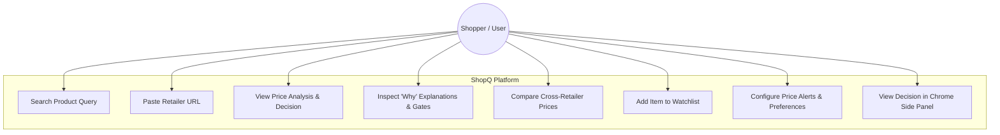
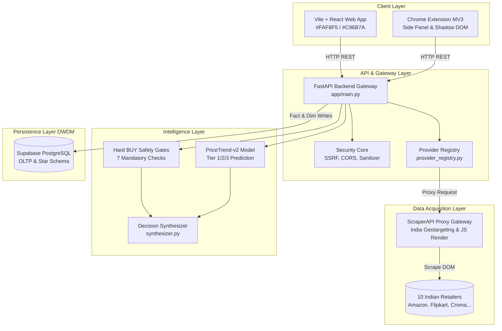
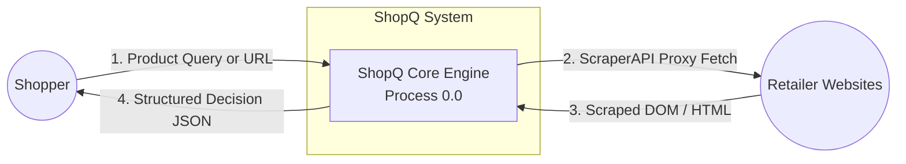
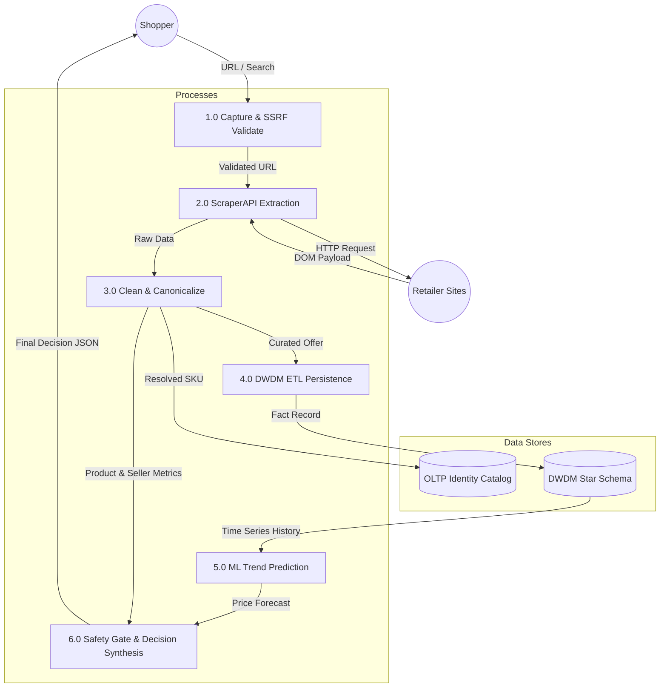
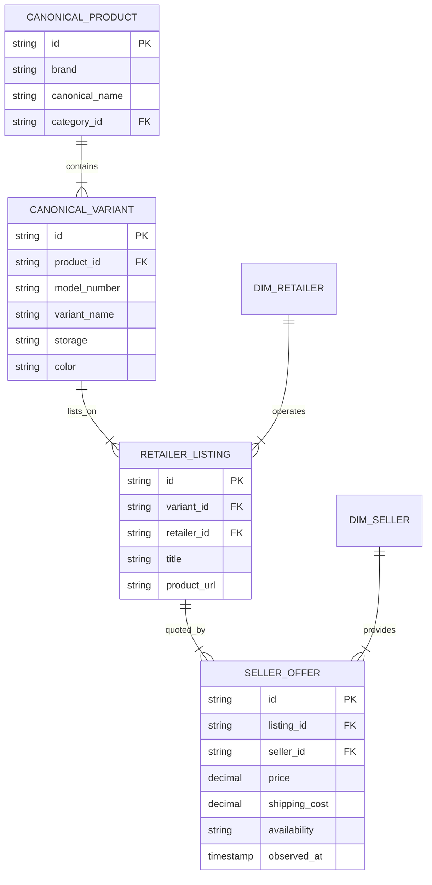
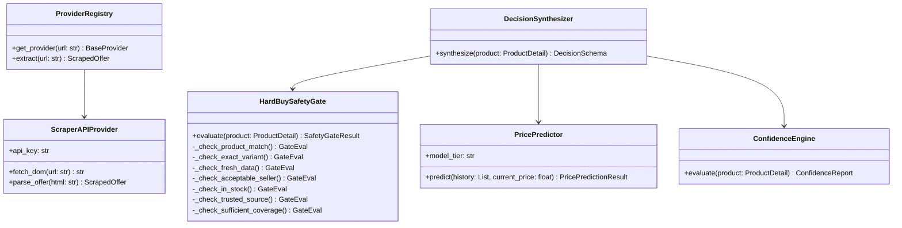
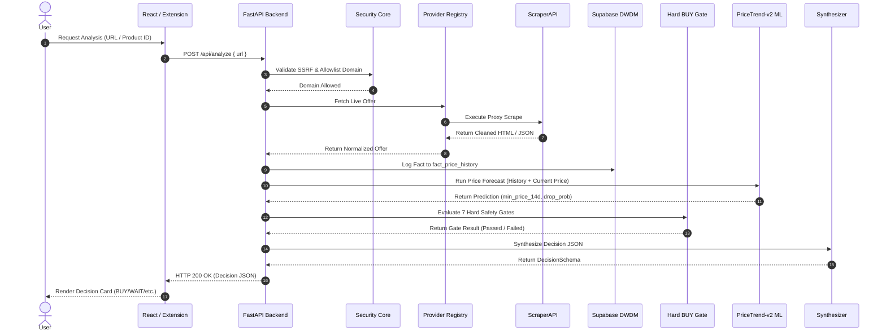
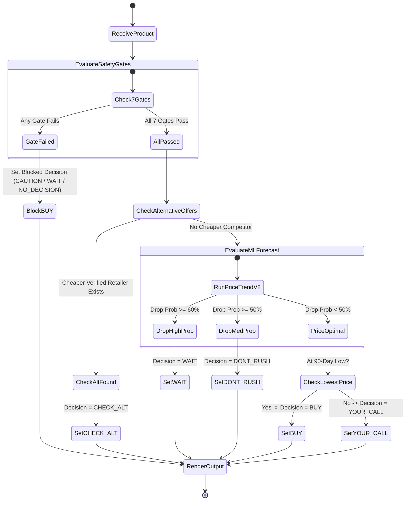
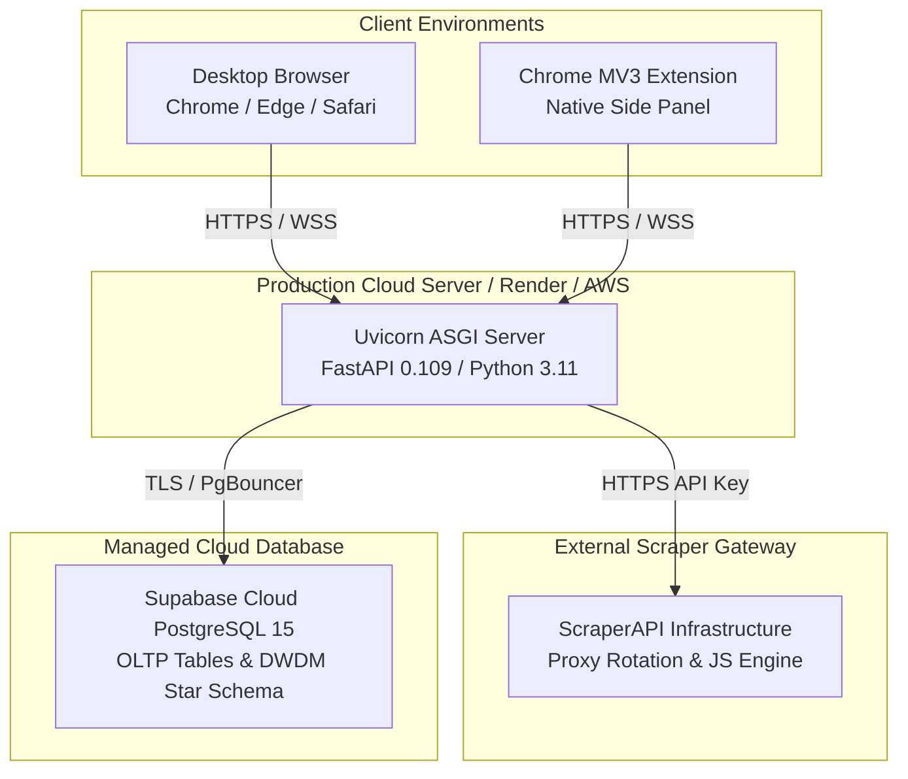

# ShopQ Architecture & System Diagrams
## Technical Diagram Suite for Academic Submission

This document contains 10 formal system architecture diagrams rendered using standard Mermaid markdown syntax.

---

### 1. Use Case Diagram

Visualizes user interactions with the Web Application and Chrome Extension across core decision workflows.



---

### 2. System Architecture Diagram

Depicts the end-to-end multi-tier architecture connecting clients, FastAPI backend modules, ScraperAPI proxy, ML engine, and Supabase DWDM.



---

### 3. Data Flow Diagram — Level 0 (Context Level DFD)

High-level boundary representation of inputs and outputs between external entities and the ShopQ System.



---

### 4. Data Flow Diagram — Level 1 (Decomposed Sub-processes DFD)

Decomposes the internal processing steps: Capture, Extraction, Resolution, Persistence, Analysis, Decision Synthesis.



---

### 5. Entity-Relationship (ER) Diagram — Operational Identity Layer

Shows the 4-level product identity hierarchy: `canonical_product` $\rightarrow$ `canonical_variant` $\rightarrow$ `retailer_listing` $\rightarrow$ `seller_offer`.



---

### 6. Class Diagram — Backend Services & Decision Architecture

Class structure of services involved in request processing, ML prediction, safety gating, and decision synthesis.



---

### 7. Sequence Diagram — Product Analysis Flow

Triggers when a user clicks analyze or inputs a URL.



---

### 8. Activity Diagram — Buy/Wait Decision Logic Flow

Step-by-step control logic evaluated by `DecisionSynthesizer`.



---

### 9. Deployment Diagram

Physical deployment topology mapping client devices, API servers, proxy cloud, and database infrastructure.



---

### 10. DWDM Star Schema Diagram

Dimensional model showing central Fact tables (`fact_price_history`, `fact_recommendation`) connected to Conformed Dimensions (`dim_product`, `dim_variant`, `dim_retailer`, `dim_seller`, `dim_category`, `dim_date`).

```mermaid
erDiagram
    FACT_PRICE_HISTORY }|--|| DIM_PRODUCT : references
    FACT_PRICE_HISTORY }|--|| DIM_VARIANT : references
    FACT_PRICE_HISTORY }|--|| DIM_RETAILER : references
    FACT_PRICE_HISTORY }|--|| DIM_SELLER : references
    FACT_PRICE_HISTORY }|--|| DIM_DATE : references

    FACT_RECOMMENDATION }|--|| DIM_PRODUCT : references
    FACT_RECOMMENDATION }|--|| DIM_DATE : references

    DIM_PRODUCT }|--|| DIM_CATEGORY : classified_by

    FACT_PRICE_HISTORY {
        bigint price_observation_id PK
        string variant_id FK
        string retailer_id FK
        string seller_id FK
        int date_key FK
        timestamp observed_at
        decimal price
        decimal shipping_cost
        boolean in_stock
    }

    FACT_RECOMMENDATION {
        string recommendation_id PK
        string product_id FK
        int date_key FK
        timestamp timestamp
        string decision
        decimal buy_point
        string confidence_level
        string primary_reason
    }

    DIM_PRODUCT {
        bigint product_key PK
        string product_id UNIQUE
        string brand
        string canonical_name
        string category_id FK
    }

    DIM_VARIANT {
        bigint variant_key PK
        string variant_id UNIQUE
        string model_number
        string storage
        string color
    }

    DIM_RETAILER {
        bigint retailer_key PK
        string retailer_id UNIQUE
        string retailer_name
        decimal reliability_score
    }

    DIM_SELLER {
        bigint seller_key PK
        string seller_id UNIQUE
        string seller_name
        decimal rating
        string reliability_tier
    }

    DIM_DATE {
        int date_key PK
        date full_date
        int month_number
        int quarter
        int year_number
        boolean is_weekend
    }
```
